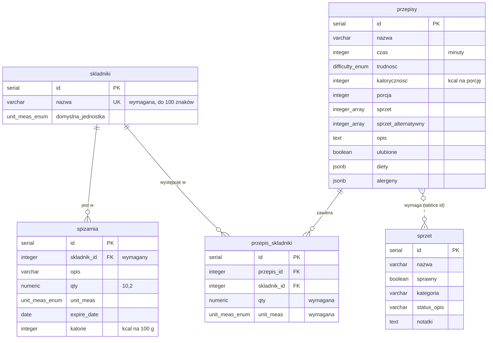

# Baza danych

Aplikacja korzysta z PostgreSQL w Supabase. Pełny schemat jest w [`db/schema.sql`](../db/schema.sql), a dane startowe w [`db/seed.sql`](../db/seed.sql).

## Diagram ERD

## Tabele

| Tabela | Przeznaczenie |
|---|---|
| `skladniki` | Słownik składników. Nazwa jest unikalna. |
| `spizarnia` | Produkty posiadane przez użytkownika: ilość, jednostka, data ważności, kalorie. |
| `sprzet` | Wyposażenie kuchni. `sprawny` decyduje o dopasowaniu przepisów, a `status_opis` podaje stan: gotowy, w naprawie lub niedostępny. |
| `przepisy` | Przepisy: czas, trudność, kaloryczność porcji, liczba porcji, opis, ulubione, diety i alergeny. |
| `przepis_skladniki` | Składniki przepisu z ilością i jednostką. |

## Relacje

| Relacja | Usuwanie |
|---|---|
| `spizarnia.skladnik_id` → `skladniki.id` | Składnika używanego w spiżarni nie można usunąć (`RESTRICT`). |
| `przepis_skladniki.skladnik_id` → `skladniki.id` | Składnika używanego w przepisie nie można usunąć (`RESTRICT`). |
| `przepis_skladniki.przepis_id` → `przepisy.id` | Usunięcie przepisu usuwa jego składniki (`CASCADE`). |

`przepisy.sprzet` i `przepisy.sprzet_alternatywny` to tablice identyfikatorów bez klucza obcego, dlatego na diagramie relacja jest przerywana. Usuwanie sprzętu czyści te tablice w API. Zamianę na tabelę łączącą opisuje SCRUM-82.

## Typy

| Typ | Wartości |
|---|---|
| `unit_meas_enum` | `kg`, `g`, `l`, `ml`, `szt`, `opak.`, `opak` |
| `difficulty_enum` | `łatwy`, `średni`, `trudny` |

## Widoki

| Widok | Zawartość |
|---|---|
| `widok_przepisy_szczegoly` | Przepis z listą składników w jednym polu tekstowym. |
| `widok_przepisy_kompletnosc` | Przepisy, dla których spiżarnia zawiera ponad 70% składników. Widok liczy same pozycje, bez porównywania ilości. |
